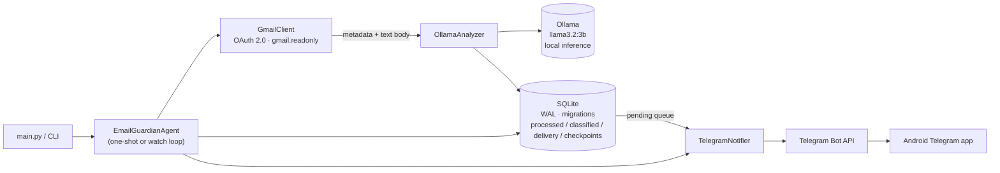

# AI Email Guardian

**Repository:** <https://github.com/vanaparthigirishkumar-spec/AI-Email-Guardian>

AI Email Guardian is an AI-powered email monitoring and notification system built with **Python, the Gmail API, Ollama, SQLite and Telegram**. It watches two Gmail accounts, decides which messages matter, summarizes them with a locally running language model, keeps a durable history, and sends actionable alerts to Telegram.

The design is local-first and privacy-conscious: Gmail access is **read-only**, email content is processed by Ollama on the same machine, and only metadata plus AI output are written to SQLite. No paid AI API is used.

---

## Project overview

- **Version:** 0.1.0
- **Local runtime:** Python 3.10+ (developed on Windows 11 / Python 3.14; deployment uses Python 3.12 on Ubuntu 24.04 LTS)
- **Accounts:** two Gmail aliases, `personal` and `work` by default
- **Retrieval:** Gmail API metadata + MIME text bodies, never attachments
- **AI:** local Ollama model (`llama3.2` by default; `llama3.2:3b` in the current deployment)
- **Storage:** versioned SQLite schema (v3) with WAL and duplicate protection
- **Delivery:** Telegram Bot API with confirmed sends and a retryable pending queue
- **Automation:** one-shot cycle or a continuous 60-second watch loop

---

## Key features

- **Two-account monitoring** — `GMAIL_ACCOUNTS` defines the only accounts processed; each alias has its own OAuth token and sync checkpoint. Personal and Work are kept strictly separate in storage, notifications and Gmail links.
- **Read-only Gmail access** — the app requests only `https://www.googleapis.com/auth/gmail.readonly`. It never sends, deletes, modifies or marks messages as read, and rejects tokens with broader scopes.
- **Local AI classification** — Ollama produces structured JSON with a category, score, summary, reason, suggested action and optional deadline. Malformed output gets one controlled correction attempt; nothing is invented.
- **Five categories** — `URGENT`, `IMPORTANT`, `NORMAL`, `PROMOTIONAL` and `SPAM`.
- **Job-related email detection** — genuine vacancies, job alerts, recruiter messages, interview invitations, application updates and offers are raised to `IMPORTANT` with a score at or above `IMPORTANCE_THRESHOLD`, even if the model would otherwise call them promotional.
- **Importance scoring and summaries** — a 0–10 score plus a short factual summary drives notification decisions and the alert text.
- **SQLite history and duplicate prevention** — processed emails, classifications, delivery status and per-account checkpoints persist across restarts. A unique `(account_alias, gmail_message_id)` constraint makes reprocessing a no-op.
- **Telegram notifications** — only `URGENT` mail and `IMPORTANT` mail scoring at or above the threshold is delivered. `NORMAL`, `PROMOTIONAL` and `SPAM` are never notified.
- **Delivery confirmation and recovery** — status becomes `SENT` only after Telegram returns a confirmed message id; pending alerts are retried at the start of the next cycle. Individual false positives can be suppressed or restored without deleting data.
- **Continuous monitoring** — `process watch` repeats the full cycle every 60 seconds (`POLL_INTERVAL_SECONDS`, minimum 10) until Ctrl+C.
- **Resilient operation** — per-account and per-message failures are logged and isolated; temporary Gmail, Ollama or Telegram errors are retried on the next cycle instead of stopping the monitor.
- **Privacy-safe logging** — bodies, snippets, prompts, OAuth tokens and bot tokens are never logged or written to the database.

---

## Architecture



**How a cycle works**

1. The CLI loads validated settings from `.env` and creates `EmailGuardianAgent`.
2. The agent retries any `PENDING` notifications left by an earlier run, then verifies that Ollama and the configured model are available.
3. For each configured account, `GmailClient` loads its own token, reads recent inbox metadata, skips ids already in SQLite, and fetches only the text body of new messages. Attachments are never downloaded.
4. `OllamaAnalyzer` sends untrusted email text to the local Ollama endpoint inside random delimiters, validates the returned JSON, applies the job-related rule, and returns a classification.
5. `EmailStore` records metadata and analysis in one transaction, sets the notification status to `PENDING` when the email qualifies, and preserves the account checkpoint.
6. `TelegramNotifier` sends qualifying alerts. Status moves to `SENT` only after Telegram confirms the message id; otherwise it becomes `FAILED`. Suppressed notifications move to the terminal `NOT_REQUIRED` state.
7. `process watch` repeats steps 2–6 every 60 seconds until Ctrl+C.

Gmail remains read-only throughout: the API is used only for profile checks, message metadata and message bodies.

**CPU inference budget.** On small CPU-only hosts, prompt length dominates latency. The analyzer therefore uses a compact system prompt (about 1.7k characters), caps email text at 2,000 characters with the opening, signal lines (e.g. deadlines and application instructions) and the ending preserved, and caps generation at 180 output tokens. Inference read timeouts are not retried immediately; timeout-shaped HTTP 500 responses are not retried either. If Ollama becomes unavailable mid-cycle, the remaining messages are deferred to the next poll instead of waiting on repeated timeouts.

---

## Local installation

### 1. Prerequisites

- Python 3.10 or newer (`py --version` on Windows, `python3 --version` on Linux)
- [Ollama](https://ollama.com/download) installed and running
- A Google Cloud project with the Gmail API enabled
- A Telegram bot created with [@BotFather](https://t.me/BotFather)

**Windows (PowerShell):**

```powershell
cd C:\Users\user\AI-Email-Guardian
py -3 -m venv .venv
.\.venv\Scripts\Activate.ps1
python -m pip install --upgrade pip
pip install -r requirements.txt
```

If PowerShell blocks activation:

```powershell
Set-ExecutionPolicy -Scope Process -ExecutionPolicy Bypass
```

**Linux:**

```bash
cd /path/to/AI-Email-Guardian
python3 -m venv .venv
source .venv/bin/activate
python -m pip install --upgrade pip
pip install -r requirements.txt
```

### 2. Ollama

Start Ollama (desktop app or `ollama serve`) and pull a model once:

```bash
ollama pull llama3.2          # matches the code default OLLAMA_MODEL=llama3.2
ollama pull llama3.2:3b       # used by the current deployment
```

Either tag works with the application; set `OLLAMA_MODEL` in `.env` to the tag you pulled. The first request may take longer while the model loads, so `OLLAMA_TIMEOUT_SECONDS` defaults to `180`, which is also the effective read-timeout cap. Inference timeouts are not retried immediately.

### 3. Environment file

```powershell
Copy-Item .env.example .env   # only if .env does not exist yet
```

```bash
cp .env.example .env
```

Set at minimum:

```dotenv
GMAIL_ACCOUNTS=personal,work
OLLAMA_MODEL=llama3.2:3b
TELEGRAM_BOT_TOKEN=<token from @BotFather>
TELEGRAM_CHAT_ID=<numeric chat id>
IMPORTANCE_THRESHOLD=7
POLL_INTERVAL_SECONDS=60
```

`.env` is ignored by Git. Never commit it or paste its contents into issues.

### 4. Gmail OAuth setup

Do this once; the same Desktop OAuth client serves both accounts.

1. Open <https://console.cloud.google.com/> and create or select a project.
2. **APIs & Services → Library** → enable **Gmail API**.
3. **APIs & Services → OAuth consent screen**:
   - User type: **External** (or **Internal** for Google Workspace).
   - Fill in app name, user support email and developer contact email.
   - **Scopes → Add or remove scopes**: add only
     `https://www.googleapis.com/auth/gmail.readonly`.
   - **Test users**: add every Gmail address you will monitor while the app is in **Testing** mode.
4. **APIs & Services → Credentials → Create credentials → OAuth client ID**:
   - Application type: **Desktop app**.
   - Download the JSON and save it as `credentials.json` in the project root.
5. Authenticate each alias separately (a browser window opens; choose the correct Google account each time):

   ```powershell
   python main.py gmail auth personal
   python main.py gmail auth work
   ```

   Tokens are written to `data/tokens/personal.json` and `data/tokens/work.json`, with local metadata files recording the authenticated address.

6. Verify the setup:

   ```powershell
   python main.py gmail accounts
   python main.py doctor --online
   ```

### 5. Telegram configuration

1. Create the bot with [@BotFather](https://t.me/BotFather) and copy its token into `TELEGRAM_BOT_TOKEN`.
2. Send any message to the bot, then discover the numeric chat id:

   ```powershell
   python main.py telegram chats --limit 20
   ```

3. Put that id in `TELEGRAM_CHAT_ID`.
4. Confirm real delivery:

   ```powershell
   python main.py telegram test
   ```

   The test verifies the bot with `getMe`, sends a plain-text message and reports success only after Telegram confirms it. The bot token is never printed or logged.

### 6. Run tests

```powershell
python -W error::ResourceWarning -m unittest discover -s tests -v
```

The suite uses mocked Gmail, Ollama and Telegram services and a temporary SQLite database; it sends no real notifications. At version 0.1.0 it contains **269 tests**.

---

## Running the application

| Command | Purpose |
|---------|---------|
| `python main.py doctor` | Offline setup report |
| `python main.py doctor --online` | Also verify both Gmail profiles |
| `python main.py gmail accounts` | Token/alias status |
| `python main.py gmail auth <alias> [--force]` | Re-authenticate one account |
| `python main.py gmail test <alias> --limit 5` | List recent message metadata only |
| `python main.py ai test <alias> --limit 3` | Fetch bodies and classify once |
| `python main.py process once` | One full cycle for both accounts, then exit |
| `python main.py process once --dry-run` | Analyze and store without delivering alerts |
| `python main.py process watch` | Continuous monitoring until Ctrl+C |
| `python main.py notifications pending` | Read-only pending alert queue |
| `python main.py notifications suppress <alias> <message-id>` | Suppress one alert without sending anything |
| `python main.py notifications unsuppress <alias> <message-id>` | Restore an eligible alert to `PENDING` |
| `python main.py telegram test` | Verify real Telegram delivery |
| `python main.py telegram chats --limit 20` | Discover chat ids |

Start one cycle:

```powershell
python main.py process once
```

Start continuous monitoring:

```powershell
python main.py process watch
```

Press **Ctrl+C** for a clean shutdown. Nothing is sent during `--dry-run`; those notifications stay `PENDING` and are delivered by the next normal or watch cycle.

---

## Configuration reference

All settings live in `.env`; `.env.example` is the documented template.

| Key | Default | Purpose |
|-----|---------|---------|
| `GMAIL_ACCOUNTS` | empty | Comma-separated aliases, e.g. `personal,work` |
| `GMAIL_CREDENTIALS_FILE` | `credentials.json` | Shared OAuth Desktop client file |
| `GMAIL_TOKEN_DIR` | `data/tokens` | Per-account token and metadata files |
| `GMAIL_QUERY` | `in:inbox newer_than:1d` | Default search; read state is deliberately ignored |
| `GMAIL_QUERY_<ALIAS>` | empty | Per-account query override |
| `GMAIL_ACCOUNT_<ALIAS>_EMAIL` | empty | Optional expected address; a mismatch aborts |
| `GMAIL_FETCH_LIMIT` | `20` | Messages fetched per poll (1–500) |
| `POLL_INTERVAL_SECONDS` | `60` | Poll interval (minimum 10) |
| `OLLAMA_BASE_URL` | `http://localhost:11434` | Local Ollama endpoint |
| `OLLAMA_MODEL` | `llama3.2` | Model used for analysis |
| `OLLAMA_TIMEOUT_SECONDS` | `180` | Per-request read timeout (capped at 180 s) |
| `TELEGRAM_BOT_TOKEN` | empty | Bot token from @BotFather |
| `TELEGRAM_CHAT_ID` | empty | Destination chat id |
| `DATABASE_PATH` | `data/emails.db` | SQLite file |
| `LOG_DIR` | `logs` | Rotating log directory |
| `LOG_LEVEL` | `INFO` | Logging level |
| `IMPORTANCE_THRESHOLD` | `7` | Score needed for an `IMPORTANT` alert (`URGENT` always alerts) |

`<ALIAS>` is uppercased with `-` replaced by `_`. Relative paths resolve against the project root.

---

## Deployment on Google Cloud

The current deployment runs on **Google Cloud Compute Engine**: Ubuntu 24.04 LTS, Python 3.12, **2 vCPU / 8 GB RAM**, Ollama with `llama3.2:3b`, SQLite, and a Linux **systemd** service running `python main.py process watch` at a 60-second interval.

This repository does not ship deployment scripts; the steps below document that setup.

### VM preparation

```bash
sudo apt update && sudo apt upgrade -y
sudo apt install -y python3.12 python3.12-venv git
git clone https://github.com/vanaparthigirishkumar-spec/AI-Email-Guardian.git /opt/ai-email-guardian
cd /opt/ai-email-guardian
python3.12 -m venv .venv
source .venv/bin/activate
pip install --upgrade pip
pip install -r requirements.txt
```

Install Ollama, start it, and pull the model:

```bash
curl -fsSL https://ollama.com/install.sh | sh
sudo systemctl enable --now ollama
ollama pull llama3.2:3b
```

Create `.env` with the same keys as locally, set `OLLAMA_MODEL=llama3.2:3b` and `POLL_INTERVAL_SECONDS=60`. Complete the Gmail OAuth flow where a browser is available and place only the resulting per-alias token files under `data/tokens/`; never upload tokens or `.env` to a public location.

Verify before enabling the service:

```bash
cd /opt/ai-email-guardian
.venv/bin/python main.py doctor
.venv/bin/python main.py telegram test
.venv/bin/python main.py process once --dry-run
```

### systemd service (example unit)

Create `/etc/systemd/system/ai-email-guardian.service` (adjust user and path):

```ini
[Unit]
Description=AI Email Guardian
After=network-online.target ollama.service
Wants=network-online.target

[Service]
Type=simple
User=YOUR_USER
WorkingDirectory=/opt/ai-email-guardian
ExecStart=/opt/ai-email-guardian/.venv/bin/python main.py process watch
Restart=always
RestartSec=10
StandardOutput=journal
StandardError=journal

[Install]
WantedBy=multi-user.target
```

The application loads `.env` itself via `python-dotenv`, so no secrets need to be placed in the unit file.

### Service commands

```bash
sudo systemctl daemon-reload
sudo systemctl enable --now ai-email-guardian   # enable and start on boot
sudo systemctl start ai-email-guardian
sudo systemctl stop ai-email-guardian
sudo systemctl restart ai-email-guardian
sudo systemctl status ai-email-guardian
sudo systemctl status ollama
```

Logs:

```bash
journalctl -u ai-email-guardian -f              # systemd output
tail -f /opt/ai-email-guardian/logs/email_guardian.log   # rotating application log
```

---

## Security

- Gmail access uses only the `gmail.readonly` scope. Tokens with broader scopes are rejected and never used; no code path sends, deletes, modifies or marks mail as read.
- Email bodies and prompts are sent only to the locally configured Ollama endpoint. Ollama runs on the same machine in both the local and GCP setups.
- Only notification metadata and AI output are stored in SQLite. Bodies, attachments, snippets, OAuth tokens and Google credentials are never written to the database.
- `.env`, `credentials.json`, `data/`, `logs/` and `.venv/` are excluded from Git. The SQLite file, its `-wal`/`-shm` sidecars and per-account token files are also ignored. Never commit or publish credentials, tokens, `.env` or private email contents.
- Logs record account aliases, message counts, message ids and classifications — not bodies, senders, subjects, snippets or secrets. Bot token text in Telegram errors is replaced with `<redacted>`; Gmail/OAuth secrets are never logged.
- Email text is treated as untrusted data: prompts instruct the model to ignore embedded instructions, and text is wrapped in per-request random delimiters. No links are opened and no code from email is executed.
- SQLite files are **not encrypted at rest**. Protect `data/` with operating-system permissions and encrypt any backups that leave the machine.
- **Gmail OAuth Testing mode:** External OAuth apps in Testing mode expire refresh tokens after seven days for Gmail scopes. Periodic reauthorization with `python main.py gmail auth <alias>` may be necessary. Publishing the app is a separate Google verification process.

---

## Known limitations

- **Gmail "Open in Gmail" button:** notifications include an inline link built from `/mail/u/0/?authuser=<authenticated account address>` and an `rfc822msgid:` search using the original RFC 822 Message-ID (angle brackets removed). It has shown "Temporary issue" redirect behaviour on a real device, so it should be treated as a best-effort convenience, **not a verified deep link**, until it is retested successfully on the target device. The notification text itself still identifies the receiving account and the email subject.
- **Cloud hosting is not permanently free:** the GCP deployment currently runs on a trial-credit account. Cost and continuity after the trial are not guaranteed, and no serverless/always-free deployment is implemented.
- **Testing-mode OAuth tokens expire after seven days** (see Security), so unattended long-running deployments need periodic reauthorization.
- **No backfill:** the default Gmail query selects recent mail (`newer_than:1d`); older messages are not imported. Change `GMAIL_QUERY` per account if a wider window is needed.
- **Delivery is best-effort:** failed sends are recorded as `FAILED`, not silently retried forever; pending sends are retried at the start of later cycles. Suppressed alerts are never retried unless explicitly restored.
- **Single-process design:** `process watch` is one foreground process. The repository contains no built-in supervisor, web UI or mobile client beyond Telegram.
- **Local AI quality:** classification depends on the installed Ollama model; malformed model output is corrected once and otherwise reported as an error.

---

## Project layout

```text
AI-Email-Guardian/
├── main.py                  Entry point for all CLI commands
├── requirements.txt         Python dependencies
├── .env.example             Documented settings template
├── .gitignore               Excludes secrets, data, logs and environments
├── email_guardian/
│   ├── cli.py               CLI commands and user-facing reports
│   ├── config.py            Settings validation and per-account paths
│   ├── logging_setup.py     Console and rotating file logging
│   ├── gmail_client.py      OAuth, profile, metadata and MIME body access
│   ├── summarizer.py        Ollama prompts, JSON validation and job rules
│   ├── storage.py           SQLite schema v3, migrations and persistence
│   ├── notifier.py          Telegram delivery, chat discovery and Gmail links
│   └── agent.py             One-shot pipeline and watch loop
├── tests/                   unittest suite with mocked external services
├── data/                    SQLite database and per-account tokens (gitignored)
└── logs/                    Rotating application logs (gitignored)
```

---

## Troubleshooting

| Symptom | Fix |
|---------|-----|
| `python` opens the Microsoft Store | Use `py -3` or install Python from python.org with "Add to PATH" |
| `Activate.ps1 cannot be loaded` | `Set-ExecutionPolicy -Scope Process -ExecutionPolicy Bypass` |
| `OAuth client file not found` | Save the Desktop-app client JSON as `credentials.json` |
| `No OAuth token stored` | Run `python main.py gmail auth <alias>` |
| Token rejected after ~7 days | Testing-mode expiry; reauthorize the alias |
| `access blocked` / `app not verified` | Add your address under OAuth consent screen → Test users |
| Wrong Google account signed in | Re-run with `--force` and choose the other account |
| `token grants broader access` | Delete `data/tokens/<alias>.json` and re-authenticate with `gmail.readonly` |
| `Ollama is not reachable` | Start Ollama (`ollama serve`) or check the systemd service |
| `Model ... is not installed` | `ollama pull llama3.2:3b` and set `OLLAMA_MODEL` accordingly |
| Slow first analysis | Increase `OLLAMA_TIMEOUT_SECONDS`; the first request loads the model |
| No Telegram message arrives | Run `python main.py telegram test`, then check `notifications pending` |
| Gmail button shows "Temporary issue" | Known limitation; use the subject/account in the alert text to find the email in Gmail |
